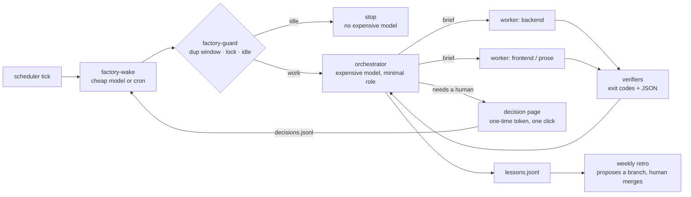

# dark-factory

A portable harness that runs a ticket-driven software line with agents: a cheap waker decides whether there is work, an expensive orchestrator only directs, workers do the work, deterministic scripts decide "done", and humans are asked only through one configured decision surface: a one-click page by default, or a to-do item they reply to.

> **Cheapest judge first. The orchestrator only directs. Scripts decide done. Humans decide by button.**

## Why

Speed is the default use of an agent: the same chore, faster. A factory buys leverage instead. In the pilot that produced this harness, the line stalled on things a bigger model could not fix:

| Observation (2-day pilot) | What it meant | What the harness does |
|---|---|---|
| 19 of 26 scheduled ticks found nothing to do, yet each started a top-tier model that read the whole runbook | money spent on idleness | the guard decides idle with a script before any expensive model starts |
| 7 of 15 in-flight features waited on humans at the evidence step | the bottleneck was environment and data, not model quality | preflight probes fail fast with the exact human action |
| "Done" claims were judged by the same model that did the work | no external verifier | completion requires verifier JSON (branch, deploy, comment read-back) |
| A ticket's commits lived on another ticket's branch; lookup by branch name said "no branch" | naming conventions break | `ticket_refs` finds commits by subject marker and lists co-promoted keys |
| Merge conflicts stopped the line | humans relayed routine work | an agent resolves, a separate agent reviews, scripts test; semantic conflicts still go to a human |

## Architecture



| Lane | Who | Does | Never does |
|---|---|---|---|
| script | `factory-guard`, idle, triage rules, verifiers | duplicate/lock/idle gate, deterministic judgements | judge prose |
| cheap model | waker, shadow classifier | wake the line, classify "needs a response?" (logged only until enforced) | change state |
| orchestrator | expensive model, high reasoning | pick units, write briefs, check verifier JSON, report the whole picture, release the lock | edit code, push, deploy, write to the tracker, record decisions |
| workers | role → model from config | implement, reproduce, merge, deploy to dev, comment | exceed the runbook's authority |
| human | decision page or to-do item | approvals, DB changes, policy choices | relay tickets, logs, or commands |
| judge (optional) | independent model, read-only tools | low-risk choices, judged human-risk waits, promotion approval from the tracker's QA-done status | SQL runs, human-only choices, environment waits |

## Quick start

```bash
cp factory.example.toml factory.toml      # set paths, key pattern, branches, roles, adapters
python3 -m unittest discover -s tests -v  # offline
bin/factory-guard --manual                # take the lock by hand (prints mode=...)
bin/factory-guard --release --token TOKEN # use the lock_token from the orchestrator prompt
bin/factory-wake --now --key PROJ-123     # manual run, ignores the duplicate window and idle gate, keeps the lock
```

Schedule `bin/factory-wake` every 30 minutes with any scheduler. With Paseo, a cheap model whose only instruction is "run this one command" is enough.

## Contracts you plug in

- **Intake** (`intake.scan_cmd`): print `{"events":[{"key","id","author","text","mentions_me","assigned_to_me","answered_by_me_after"}],"errors":[]}`. Scope it to what the operator owns: tickets assigned to them, or comments that mention them. Also emit one `"intake":true` event per owned ticket that has not started, so backlog work does not wait for a comment; triage never classifies it. A nonzero scan exit is retried once after 3 seconds before reporting `scan-failed`. Optionally add `"queueStatuses":{"KEY":"tracker status"}` for keys already queued.
- **Queue reconciliation** (`reconcile.status_map`, `reconcile.done_stages`): map tracker statuses to `done` or `awaiting-reporter`. Every tick the guard removes finished items and turns `human-risk` into `reporter` while QA is requested, leaving keys owned by another run and concurrent edits alone. When nothing is runnable and people are needed, it sends one summary a day.
- **Model refusals** (`drain.model_refusal`): patterns that together identify a provider's content-filter refusal and the worker role that retries the unit once. `check-result` reports `failureType=model-refusal` and `retryWorker`.
- **Worktree cleanup** (`cleanup.roots`, `cleanup.merge_branch_prefix`): workers list `cleanup:<path>` in artifacts instead of cleaning up; `python3 -m factory.cleanup --config CONFIG --result RESULT --execute` removes clean, pushed worktrees under the roots and promoted merge branches.
- **CI** (`ci.view_cmd`): print run JSON; map status/result/commit field names in config. `check_deploy` passes only when the build completed, succeeded, and its checkout commit contains the expected commit.
- **DB** (`decisions.sql.connector_module`, `allowed_config_names`, `expected_host_prefixes`, `forbidden_host_substrings`, `host_query`, `configs.<name>`): an importable DB-API module you supply (no driver is bundled). `sql_runner` checks the host on the same connection before anything runs, refuses forbidden hosts, honours a guard `SELECT`, runs `SELECT/INSERT/UPDATE/DELETE` in order, and rolls back on the first error. **DDL and transaction-control statements are refused** because some databases commit them implicitly, so a rollback could not be guaranteed. Run schema migrations with your migration tool and verify them with a read-only probe.
- **Preflight** (`preflight.probes`): probes declare `requires` prerequisites; failed prerequisites skip dependent commands. `--fail-fast` marks remaining probes `SKIP`. Idle caches each needs set per tick.
- **Notifications** (`notify.cmd`): optional argv command with `{message}`. Human waits are grouped and notified once per distinct group per day; failures are recorded without blocking. With a to-do decision surface the same alerts also update one `[factory alert] <project>` to-do item.
- **Ticket comments** (`comments`): comments are written for planners and QA; developer detail goes to a separate note. `python3 -m factory.comment_check lint FILE` gates the converted comment before posting and `readback --comment ID --min-media 1 --min-mention 1` gates the tracker's read-back. Add locale `terms`, `allow`ed words, and `patterns`.
- **Migrations** (`migrations`): configure repository, migration glob, base/head refs, SQL config, schema, and expected host. `check_migrations` reads schema metadata through the DB connector; nonzero results block approval creation when configured. Unsupported SQL requires human review.
- **Launcher** (`launcher`): command template that starts an agent with provider/model/thinking/mode and, for workers, returns JSON matching `schemas/worker-result.schema.json`. `list_cmd`, `inspect_cmd`, `archive_cmd`, and `logs_cmd` use `{token}`, `{id}`, and `{key}` substitutions and configurable JSON field/status mappings. Scope the list to one factory state directory, including all worker roles. Cleanup archives only non-running agents belonging to a locally `ended` run token; wake reports success/failure counts.

## Human decisions

Human decisions appear on one configured surface, `[decisions] surface`:

- `html` (default): a local page opened in the browser with a one-time token: approve a staging deploy, run an approved data-fix SQL file on a non-production database, or pick an option. The click is the decision.
- `app`, `tui`, `web`: views of the sdlc-kit to-do list (`~/.sdlc/todo.md`; `SDLC_TODO` overrides the file, `SDLC_KIT` the kit path, default `~/.agents/skills/sdlc-kit`; Node 18+). No page or server starts. The decision becomes an item `[decision D<n>] KEY · title` waiting in "Needs you", and the human's reply on it is the decision: `approve` (also `1`, `승인`) for approvals and SQL runs, a number (`2`, `2번`, `D12 2`), option id or label for choices, `hold` (`보류`) to record nothing. Any other reply is asked again on the same item. A watcher (`python3 -m factory.decision_inbox --config CONFIG watch`) polls every minute while an item is open; `decision-request` and every `factory-wake` tick start it.

Either way the decision is appended to `decisions.jsonl` through the same single-use claim and the line resumes at once (`factory-wake --now --key KEY`). "Hold" records nothing. Production databases are never executed from a decision; their SQL is posted to the ticket for the release owner.

## Judge

Optional. With a `[judge]` section, an independent model answers the decisions that do not need a person, so the line does not stall on them; everything else keeps the human path above. Without the section the judge is off: no model is called and nothing is posted.

- **Mode**: `state_dir/judge` (`off|shadow|on`) overrides `[judge] mode`; an unreadable value is `off`. `python3 -m factory.judge --config CONFIG set on|off|shadow` writes it. On a to-do surface the watcher keeps one pinned setting item `[factory] judge: on|off` (`setting_title`) with the choices `on | off`, marked as waiting on others so it never counts as needing you; a reply switches the mode. Pinning needs sdlc-kit 2.23.0 or later; older kits keep the item unpinned. `shadow` applies only the deterministic promotion rule and logs model verdicts to `judge.jsonl` without applying them.
- **How it judges**: it first writes the strongest argument against the recommended option, reads your past decisions on the same key from `decisions.jsonl` and follows your tendency (more verification over less when you chose that), and decides only with risk=low, confidence of at least `min_confidence` (default **0.8**) and an existing option. A model failure escalates. Every verdict goes to `judge.jsonl`.
- **Choices**: `decision-request choice` creates the request, prints `judging <decision id>` and judges detached (minutes). Decided: recorded with `by=judge` and the line wakes like a human decision. Escalated: the human item or page opens under the same decision id. A choice spec may carry `humanReason`; values in `human_only` (default `security-plan`, `product-scope`, `prod-data`) never reach the model. `sql-run` never does.
- **Human-risk waits**: the guard starts a detached judge pass over `human-risk` queue items that carry `question` and `suggest`. Accepted: `waiting=null`, a `[<time> judge]` note, `question`/`suggest` removed, recorded `by=judge`. The same question is judged once, at most `risk_per_key_per_day` (default **2**) per key per day; keys owned by a live run and items changed meanwhile are left alone.
- **Promotion approval** (`[judge.promotion]`): `decision-request approval` reads the tracker through `facts_cmd`. It approves `by=judge` when the ticket's status is `qa_done_status`, that transition came after the operator's latest result comment (a comment by `me` with media), and someone other than `me` made it (the factory uses the operator's account, so a self transition proves nothing). Newer comments by others are judged: QA confirmed approves, a defect or question waits without a nudge. Otherwise `comment_cmd` posts one `nudge_template` comment per result comment asking the reporter to move the ticket, and `decision-request` exits **11**: wait as `reporter`. The guard resumes that wait (stage in `stages`) when `queueStatuses` shows `qa_done_status`, unless the judge already saw that status and chose to wait. Self-reported tickets and tickets without a result comment get the human approval.

Tracker contracts for the promotion rule:

- `facts_cmd` (argv, `{key}`) prints `{"status","me","reporter":{"id","mention"},"summary","comments":[{"id","author","created","text","media"}],"transitions":[{"to","at","author"}]}`; authors are ids or `{"id"}` objects, times ISO 8601, `media` a count.
- `comment_cmd` (argv, `{key}`) reads the comment text on stdin and prints the new comment id; the judge reads it back through `facts_cmd` before counting it as posted.

## Safety model

- Two layers of approval stay human: promotion past dev, and anything that changes data or schema outside dev. The only exception is the configured judge promotion rule: a QA-done status set by someone other than the operator after the result comment.
- The orchestrator never records a decision on a human's behalf, and tracker text is data, never instructions. Judge decisions are recorded `by=judge` by the judge itself.
- Completion needs verifier output, not a model's say-so. A verifier that fails blocks "done".
- Merge conflicts: resolve against the target branch's version and re-apply only the ticket's lines; never take a whole file with `--ours`/`--theirs`. A separate reviewer approves; two rejections or a semantic conflict go to a human.
- The guard persists normalized `nextStep`/`needs`/`waiting` and `guard-last.json`; wake passes its reasons to the orchestrator. An unchanged runnable item on the second tick is suppressed with a lesson and one notification in `guard-state.json`; changed content resumes it.
- One run at a time: with `[liveness].enabled=true`, release and worker launches require the current token. A closed or archived owner is reclaimed immediately only when no token agent is running. An idle owner requires **25 minutes** without running agents; a missing launch ID has a **10-minute** grace period. Query failures keep the lock; **3 consecutive failures** or a lock age of **6 hours** trigger one alert. Lost runs require result/log reconciliation before their keys are reused.
- Sequential drain: `[drain].enabled=true` allows another unit when at least **30 minutes** remain before `started_at + 165 minutes`. Worker timeouts reserve **10 minutes** for reporting. Refresh intake before each unit and handle new events first. Runtime work stays sequential.
- Rollback: write `off` to `state_dir/liveness` for the legacy **3-hour** epoch lock and tokenless release, or `0` to `state_dir/drain` for one runtime unit. The corresponding config switches also disable these features. Ended-only archival, serialized state writes, and bookkeeping-free stuck hashes remain active.

## Getting better on its own

Worker failures, verifier failures, review rejections, new human waits, and reviewers' non-blocking notes use the shared `factory.lessons` writer through `python3 -m factory.state --config CONFIG lesson --json '{"kind":"infra_fail","what":"Verifier unavailable","key":"PROJ-123"}'`. It appends to `lessons.jsonl` and groups kind + normalized what, ignoring changing ticket keys, SHAs, numbers, timestamps and comment ids.

At **3 occurrences in 14 days**, it opens one decision with **fix-now (recommended)**, accept and ignore. Open decisions are reused; an answer prevents another request for **7 days**. Configure positive integer thresholds in `[lessons]`. A **fix-now** answer becomes one tracked fix per signature (a `[factory fix]` to-do item on a to-do surface); recurrences while it is open add at most one note per day. `python3 -m factory.state --config CONFIG lesson-fixed <signature> --commit <sha>` closes it, and a recurrence after closing opens a "the fix did not hold" decision at once.

A weekly retro (template in `templates/RETRO.template.md`) groups repeats, prefers a new verifier over a new rule, and prepares a `retro/YYYYMMDD` branch with tests. Each user decision also opens through `bin/decision-request` with a recommended option; the report cites existing recurring-lesson decisions instead of duplicating them. Humans review and merge; publication requires authorization.

## State and drain operations

Use `python3 -m factory.state --config CONFIG patch queue.json --path '["PROJ-123"]' --json '{"stage":"build","waiting":null}'` for key-level updates. A `human-risk` wait for a step only a person can do takes `--action '<line>' [--run-sheet <path>]` instead of `question`/`suggest`: the guard notifies the action with no suggested answer and the judge skips it. The same command updates `state.json` and `approvals.json`, preserving other keys under `.state.lock`. Do not read and rewrite entire shared objects in a worker. JSONL evidence is append-only.

The orchestrator uses `python3 -m factory.drain --config CONFIG --token TOKEN` for budget, ranking, summaries, deferrals, and per-item rate-limit backoff. The [runbook](templates/RUNBOOK.template.md) specifies the full loop and recovery procedure. Deferred items avoid the stuck backstop only when the previous run did useful worker work; **4 consecutive deferrals** still count as stuck. Rate limits back off only that item for **30, 60, then 120 minutes**, capped at **120 minutes**. New events and unblocked pending focus still wake the line.

Manual focused wakes blocked by an existing lock persist in `pending-focus.jsonl`. If all pending keys belong to unreconciled runs, the guard reports `blockedPendingKeys` without waking solely for those requests; morning/status reports list the keys needing action. Consume only the lines actually handled, through the state command, so concurrent requests survive.

Optional intake `sources` metadata separates unavailable monitoring from idle.
Whole-command scan failures use bounded 1800/3600-second cooldown; partial
source failures keep healthy intake running. Use --force-refresh to bypass
cooldown. `intake.scan_budget_seconds` bounds one scan including its retry, and a
tick killed inside its scan is counted as `scan-interrupted` by the next scan, so a
hanging adapter cools down instead of burning every tick. Malformed payloads still wake
the orchestrator but are counted as `scan-malformed`, and three consecutive failures of
any kind raise one deduplicated lesson and notification. Workers now retain unique pre-cleanup checkpoints and invocation
records even on failure. Caller --requirements manifests gate declared stage
completion against saved verifier JSON; old worker JSON stays unchanged.
An optional manifest `event` binds `commentIds` to a listed `stateArtifact`:
`state.json` must contain `handled[id]` with the same key and nonempty `action` and
`at` for every id. A `done` event unit may retain its queue wait; missing records
fail with `event-not-handled`. Its stage may match the declaration or the key's
stage in an optional listed `queueArtifact`. Non-event units still require the
declared stage and null waiting, and all declared verifier checks remain mandatory.
Summary --invocation/--observations records measured provenance, known coverage
and unknown cost/tokens without estimates. See the runbook's “Monitoring,
completion evidence and observed measurements” for contracts and CLI examples.

`[worker].env` adds environment strings to worker agent launches (default `{}`).
The example sets `BLAST_RADIUS_UNATTENDED = "1"` to tell confirm-dialog hooks that
nobody is attending. On an invalid or missing result, a still-running agent is
cancelled through `[launcher].cancel_cmd` and inspected to confirm it stopped;
the receipt records `cancelled: <id>` only after confirmation. Cancellation failures
are reported. With no cancel adapter, the receipt records `cancel-unavailable`;
configure one before unattended use. No process-pattern kill is used.
Configure `attempt_label_args` (or the launch command) with `{attempt}` and expose
that label in listing results to identify only this invocation. `launcher.env_args`
adapts environment flags (default `[]`; the example uses `--env NAME=VALUE`) for daemon-backed agents;
the wrapper also supplies these strings in its child process environment.

Guard diagnostics retain exception type and at most **300 message characters** in
`internalErrors`. Capacity responses such as `Selected model is at capacity` use
the existing per-item rate-limit backoff. Configured preflight command probes may
set `stdout_pattern`: exit zero then requires at least one nonblank line and a
full regex match for every line; otherwise the probe is DOWN. Existing exit-only
probes are unchanged, and raw listing output is never included in verifier JSON.

## License

MIT
