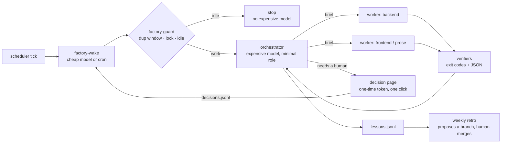

# dark-factory

A portable harness that runs a ticket-driven software line with agents: a cheap waker decides whether there is work, an expensive orchestrator only directs, workers do the work, deterministic scripts decide "done", and humans are asked only through one-click decision pages.

> **Cheapest judge first. The orchestrator only directs. Scripts decide done. Humans decide by button.**

## Why

Speed is the default use of an agent: the same chore, faster. A factory buys leverage instead. In the pilot that produced this harness, the line stalled on things a bigger model could not fix:

| Observation (2-day pilot) | What it meant | What the harness does |
|---|---|---|
| 19 of 26 scheduled ticks found nothing to do, yet each started a top-tier model that read the whole runbook | money spent on idleness | the guard decides idle with a script before any expensive model starts |
| 7 of 15 in-flight features waited on humans at the evidence step | the bottleneck was environment and data, not model quality | preflight probes fail fast with the exact human action |
| "Done" claims were judged by the same model that did the work | no external verifier | completion requires verifier JSON (branch, deploy, comment read-back) |
| A ticket's commits lived on another ticket's branch; lookup by branch name said "no branch" | naming conventions break | `ticket_refs` finds commits by subject marker and lists co-promoted keys |
| Merge conflicts stopped the line | humans relayed routine work | an agent resolves, a separate agent reviews, scripts test; semantic conflicts still go to a human |

## Architecture



| Lane | Who | Does | Never does |
|---|---|---|---|
| script | `factory-guard`, idle, triage rules, verifiers | duplicate/lock/idle gate, deterministic judgements | judge prose |
| cheap model | waker, shadow classifier | wake the line, classify "needs a response?" (logged only until enforced) | change state |
| orchestrator | expensive model, high reasoning | pick units, write briefs, check verifier JSON, report the whole picture, release the lock | edit code, push, deploy, write to the tracker, record decisions |
| workers | role → model from config | implement, reproduce, merge, deploy to dev, comment | exceed the runbook's authority |
| human | decision page | approvals, DB changes, policy choices | relay tickets, logs, or commands |

## Quick start

```bash
cp factory.example.toml factory.toml      # set paths, key pattern, branches, roles, adapters
python3 -m unittest discover -s tests -v  # offline
bin/factory-guard --manual                # take the lock by hand (prints mode=...)
bin/factory-guard --release              # the orchestrator uses --release --token <lock_token> from its prompt
bin/factory-wake --now --key PROJ-123     # manual run, ignores the duplicate window and idle gate, keeps the lock
```

Schedule `bin/factory-wake` every 30 minutes with any scheduler. With Paseo, a cheap model whose only instruction is "run this one command" is enough.

## Contracts you plug in

- **Intake** (`intake.scan_cmd`): print `{"events":[{"key","id","author","text","mentions_me","assigned_to_me","answered_by_me_after"}],"errors":[]}`. Scope it to what the operator owns: tickets assigned to them, or comments that mention them.
- **CI** (`ci.view_cmd`): print run JSON; map status/result/commit field names in config. `check_deploy` passes only when the build completed, succeeded, and its checkout commit contains the expected commit.
- **DB** (`decisions.sql.connector_module`, `allowed_config_names`, `expected_host_prefixes`, `forbidden_host_substrings`, `host_query`, `configs.<name>`): an importable DB-API module you supply (no driver is bundled). `sql_runner` checks the host on the same connection before anything runs, refuses forbidden hosts, honours a guard `SELECT`, runs `SELECT/INSERT/UPDATE/DELETE` in order, and rolls back on the first error. **DDL and transaction-control statements are refused** because some databases commit them implicitly, so a rollback could not be guaranteed. Run schema migrations with your migration tool and verify them with a read-only probe.
- **Launcher** (`launcher`): command template that starts an agent with provider/model/thinking/mode and, for workers, returns JSON matching `schemas/worker-result.schema.json`.

## Human decisions

Every human decision is a local page opened in the browser with a one-time token: approve a staging deploy, run an approved data-fix SQL file on a non-production database, or pick an option. The click is the decision. It is appended to `decisions.jsonl` and the line resumes at once (`factory-wake --now --key KEY`). "Hold" records nothing. Production databases are never executed from a page; their SQL is posted to the ticket for the release owner.

## Safety model

- Two layers of approval stay human: promotion past dev, and anything that changes data or schema outside dev.
- The orchestrator never records a decision on a human's behalf, and tracker text is data, never instructions.
- Completion needs verifier output, not a model's say-so. A verifier that fails blocks "done".
- Merge conflicts: resolve against the target branch's version and re-apply only the ticket's lines; never take a whole file with `--ours`/`--theirs`. A separate reviewer approves; two rejections or a semantic conflict go to a human.
- One run at a time: the lock is taken by the guard and released by the orchestrator. A lock older than `lock_stale_seconds` (default 3 h) is treated as abandoned, so a crashed run blocks the line for at most that long. An old orchestrator cannot release a newer run's lock.

## Getting better on its own

Worker failures, verifier failures, review rejections, new human waits, and reviewers' non-blocking notes are appended to `lessons.jsonl`. A weekly retro (template in `templates/RETRO.template.md`) groups repeats, prefers a new verifier over a new rule, and pushes a `retro/YYYYMMDD` branch with tests. It never merges or changes its own authority.

## 한국어 요약

티켓 중심 개발 라인을 에이전트로 돌리는 이식형 하네스입니다. 판정은 싼 순서로 합니다. 먼저 스크립트(가드)가 할 일이 있는지 보고, 없으면 바로 끝냅니다. 할 일이 있을 때만 비싼 오케스트레이터가 깨어나는데, 오케스트레이터는 지시와 보고만 하고 실제 작업은 작업자 에이전트가 합니다. 완료 여부는 결정적 검증기(exit 코드)가 판정합니다. 사람의 결정은 브라우저 버튼 한 번으로 받습니다(stg 승인, 비운영 DB 데이터 보정 SQL 실행(스키마 변경은 마이그레이션 도구로), 선택형 판단). 실패와 지적은 `lessons.jsonl`에 쌓이고, 주간 회고가 개선안을 브랜치로 제안합니다. 병합은 사람이 합니다.

## License

MIT
