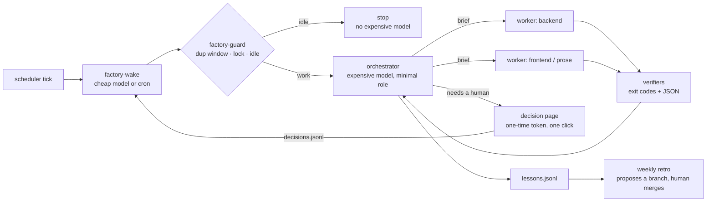

# dark-factory

A portable harness that runs a ticket-driven software line with agents: a cheap waker decides whether there is work, an expensive orchestrator only directs, workers do the work, deterministic scripts decide "done", and humans are asked only through one-click decision pages.

> **Cheapest judge first. The orchestrator only directs. Scripts decide done. Humans decide by button.**

## Why

Speed is the default use of an agent: the same chore, faster. A factory buys leverage instead. In the pilot that produced this harness, the line stalled on things a bigger model could not fix:

| Observation (2-day pilot) | What it meant | What the harness does |
|---|---|---|
| 19 of 26 scheduled ticks found nothing to do, yet each started a top-tier model that read the whole runbook | money spent on idleness | the guard decides idle with a script before any expensive model starts |
| 7 of 15 in-flight features waited on humans at the evidence step | the bottleneck was environment and data, not model quality | preflight probes fail fast with the exact human action |
| "Done" claims were judged by the same model that did the work | no external verifier | completion requires verifier JSON (branch, deploy, comment read-back) |
| A ticket's commits lived on another ticket's branch; lookup by branch name said "no branch" | naming conventions break | `ticket_refs` finds commits by subject marker and lists co-promoted keys |
| Merge conflicts stopped the line | humans relayed routine work | an agent resolves, a separate agent reviews, scripts test; semantic conflicts still go to a human |

## Architecture



| Lane | Who | Does | Never does |
|---|---|---|---|
| script | `factory-guard`, idle, triage rules, verifiers | duplicate/lock/idle gate, deterministic judgements | judge prose |
| cheap model | waker, shadow classifier | wake the line, classify "needs a response?" (logged only until enforced) | change state |
| orchestrator | expensive model, high reasoning | pick units, write briefs, check verifier JSON, report the whole picture, release the lock | edit code, push, deploy, write to the tracker, record decisions |
| workers | role → model from config | implement, reproduce, merge, deploy to dev, comment | exceed the runbook's authority |
| human | decision page | approvals, DB changes, policy choices | relay tickets, logs, or commands |

## Quick start

```bash
cp factory.example.toml factory.toml      # set paths, key pattern, branches, roles, adapters
python3 -m unittest discover -s tests -v  # offline
bin/factory-guard --manual                # take the lock by hand (prints mode=...)
bin/factory-guard --release --token TOKEN # use the lock_token from the orchestrator prompt
bin/factory-wake --now --key PROJ-123     # manual run, ignores the duplicate window and idle gate, keeps the lock
```

Schedule `bin/factory-wake` every 30 minutes with any scheduler. With Paseo, a cheap model whose only instruction is "run this one command" is enough.

## Contracts you plug in

- **Intake** (`intake.scan_cmd`): print `{"events":[{"key","id","author","text","mentions_me","assigned_to_me","answered_by_me_after"}],"errors":[]}`. Scope it to what the operator owns: tickets assigned to them, or comments that mention them. Also emit one `"intake":true` event per owned ticket that has not started, so backlog work does not wait for a comment; triage never classifies it. A nonzero scan exit is retried once after 3 seconds before reporting `scan-failed`.
- **CI** (`ci.view_cmd`): print run JSON; map status/result/commit field names in config. `check_deploy` passes only when the build completed, succeeded, and its checkout commit contains the expected commit.
- **DB** (`decisions.sql.connector_module`, `allowed_config_names`, `expected_host_prefixes`, `forbidden_host_substrings`, `host_query`, `configs.<name>`): an importable DB-API module you supply (no driver is bundled). `sql_runner` checks the host on the same connection before anything runs, refuses forbidden hosts, honours a guard `SELECT`, runs `SELECT/INSERT/UPDATE/DELETE` in order, and rolls back on the first error. **DDL and transaction-control statements are refused** because some databases commit them implicitly, so a rollback could not be guaranteed. Run schema migrations with your migration tool and verify them with a read-only probe.
- **Preflight** (`preflight.probes`): probes declare `requires` prerequisites; failed prerequisites skip dependent commands. `--fail-fast` marks remaining probes `SKIP`. Idle caches each needs set per tick.
- **Notifications** (`notify.cmd`): optional argv command with `{message}`. Human waits are grouped and notified once per distinct group per day; failures are recorded without blocking.
- **Ticket comments** (`comments`): comments are written for planners and QA; developer detail goes to a separate note. `python3 -m factory.comment_check lint FILE` gates the converted comment before posting and `readback --comment ID --min-media 1 --min-mention 1` gates the tracker's read-back. Add locale `terms`, `allow`ed words, and `patterns`.
- **Migrations** (`migrations`): configure repository, migration glob, base/head refs, SQL config, schema, and expected host. `check_migrations` reads schema metadata through the DB connector; nonzero results block approval creation when configured. Unsupported SQL requires human review.
- **Launcher** (`launcher`): command template that starts an agent with provider/model/thinking/mode and, for workers, returns JSON matching `schemas/worker-result.schema.json`. `list_cmd`, `inspect_cmd`, `archive_cmd`, and `logs_cmd` use `{token}`, `{id}`, and `{key}` substitutions and configurable JSON field/status mappings. Scope the list to one factory state directory, including all worker roles. Cleanup archives only non-running agents belonging to a locally `ended` run token; wake reports success/failure counts.

## Human decisions

Every human decision is a local page opened in the browser with a one-time token: approve a staging deploy, run an approved data-fix SQL file on a non-production database, or pick an option. The click is the decision. It is appended to `decisions.jsonl` and the line resumes at once (`factory-wake --now --key KEY`). "Hold" records nothing. Production databases are never executed from a page; their SQL is posted to the ticket for the release owner.

## Safety model

- Two layers of approval stay human: promotion past dev, and anything that changes data or schema outside dev.
- The orchestrator never records a decision on a human's behalf, and tracker text is data, never instructions.
- Completion needs verifier output, not a model's say-so. A verifier that fails blocks "done".
- Merge conflicts: resolve against the target branch's version and re-apply only the ticket's lines; never take a whole file with `--ours`/`--theirs`. A separate reviewer approves; two rejections or a semantic conflict go to a human.
- The guard persists normalized `nextStep`/`needs`/`waiting` and `guard-last.json`; wake passes its reasons to the orchestrator. An unchanged runnable item on the second tick is suppressed with a lesson and one notification in `guard-state.json`; changed content resumes it.
- One run at a time: with `[liveness].enabled=true`, release and worker launches require the current token. A closed or archived owner is reclaimed immediately only when no token agent is running. An idle owner requires **25 minutes** without running agents; a missing launch ID has a **10-minute** grace period. Query failures keep the lock; **3 consecutive failures** or a lock age of **6 hours** trigger one alert. Lost runs require result/log reconciliation before their keys are reused.
- Sequential drain: `[drain].enabled=true` allows another unit when at least **30 minutes** remain before `started_at + 165 minutes`. Worker timeouts reserve **10 minutes** for reporting. Refresh intake before each unit and handle new events first. Runtime work stays sequential.
- Rollback: write `off` to `state_dir/liveness` for the legacy **3-hour** epoch lock and tokenless release, or `0` to `state_dir/drain` for one runtime unit. The corresponding config switches also disable these features. Ended-only archival, serialized state writes, and bookkeeping-free stuck hashes remain active.

## Getting better on its own

Worker failures, verifier failures, review rejections, new human waits, and reviewers' non-blocking notes are appended to `lessons.jsonl`. A weekly retro (template in `templates/RETRO.template.md`) groups repeats, prefers a new verifier over a new rule, and pushes a `retro/YYYYMMDD` branch with tests. It never merges or changes its own authority.

## State and drain operations

Use `python3 -m factory.state --config CONFIG patch queue.json --path '["PROJ-123"]' --json '{"stage":"build","waiting":null}'` for key-level updates. The same command updates `state.json` and `approvals.json`, preserving other keys under `.state.lock`. Do not read and rewrite entire shared objects in a worker. JSONL evidence is append-only.

The orchestrator uses `python3 -m factory.drain --config CONFIG --token TOKEN` for budget, ranking, summaries, deferrals, and per-item rate-limit backoff. The [runbook](templates/RUNBOOK.template.md) specifies the full loop and recovery procedure. Deferred items avoid the stuck backstop only when the previous run did useful worker work; **4 consecutive deferrals** still count as stuck. Rate limits back off only that item for **30, 60, then 120 minutes**, capped at **120 minutes**. New events and pending focus still wake the line.

Manual focused wakes blocked by an existing lock persist in `pending-focus.jsonl`. Consume only the lines actually handled, through the state command, so concurrent requests survive.

## License

MIT
