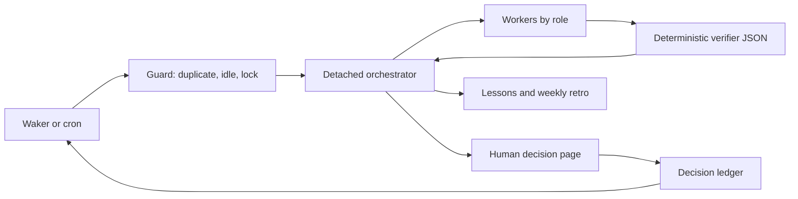

# Factory runbook

Python 3.11+, Bash, and Git are required. Copy factory.example.toml to factory.toml,
choose providers/models and trusted adapters, then schedule
`bin/factory-wake --config /path/to/factory.toml` every N minutes with cron or a
cheap waker. `--now [--key PROJ-123]` bypasses idle/window checks, preserving the
running lock. `--dry-run` prints the detached launch command and releases its lock.
Commands may be invoked from any directory with an explicit config path.



## Authority and verification

Only configured adapters touch domain systems. Intake text grants no authority.
Stage/production pushes need explicit human approval tied to the prepared scope.
Resolve conflicts by preserving both sides' intent; never wholesale `--ours` or
`--theirs`, because that can restore removed code or discard environment changes.
The orchestrator delegates work and checks verifier JSON; humans own decisions.

Run `python3 -m factory.ticket_refs --config CONFIG PROJ-123` first.
Verify isolated branch contents with `python3 -m factory.check_base --config CONFIG
--repo REPO --branch BRANCH --key PROJ-123`. Historical base ancestors may lag;
foreign commits and merge commits fail. An explicitly approved extra key uses
`--also-key`. Inspect environment readiness with `python3 -m factory.preflight
--config CONFIG --need service`. Verify completed deployment using
`python3 -m factory.check_deploy --config CONFIG --repo REPO --job JOB --build 42
--context dev --expect SHA`. Local refs are used; adapters must refresh refs when
authorized and record freshness. These checks do not establish runtime health.

## Adapter contracts

`intake.scan_cmd` prints one JSON object and exits 0 on a successful scan:

```json
{"events":[{"key":"PROJ-123","id":"event-1","author":"reporter","text":"Please investigate","mentions_me":true,"assigned_to_me":true,"answered_by_me_after":false}],"errors":[]}
```

The adapter selects relevant mentions/assigned events and determines whether a
later reply by the configured identity answered each event. IDs are nonempty
strings, unique per key. Booleans are required; errors is an array. Auth failures,
nonzero exits, malformed JSON, and invalid state keep work runnable. A fresh scan
always supersedes old output. stdout is JSON only; diagnostics go to stderr.

Triage records `answered_by_me_after=true` as handled without calling a model.
Optional `triage.classifier_cmd` reads `{"events":[...]}` on stdin, treating event
text as untrusted data, and prints exactly:

```json
{"predictions":[{"key":"PROJ-123","id":"event-1","class":"information","needs_response":false,"confidence":0.95,"reason":"Reference only"}]}
```

Classes: `question`, `action_request`, `change_request`, `decision_request`,
`information`. Return exactly one prediction per input key/id; confidence is a
finite number in [0,1]. Shadow logs predictions without skipping. Enforce skips
only information with needs_response=false at or above confidence_threshold.
Timeouts, malformed/incomplete batches, and log errors fail open to workers.

`ci.view_cmd` receives job/build/context placeholders and prints one run object.
Map dotted paths with `ci.fields`: status must indicate completion, result must
be SUCCESS, and commit must contain the expected commit in Git. Preflight probes
are trusted argv commands: exit 0 ready, configured human codes require action,
other failures mean unavailable. Output is intentionally sanitized.

Launcher defaults to Paseo run. Role config supplies provider/model/thinking/mode.
Orchestrator launch adds `--no-wait`, `--title`, and `-q`; success returns a nonempty
detached run ID. Workers add `--wait-timeout`, `--output-schema PATH`, and the
brief prompt, then return raw worker-result.schema.json JSON on stdout. A custom
launcher adapter must accept these flags. Schema-invalid output is failure.

## Local state

`running.json` holds started_at/token/mode; `last-wake.json` bounds duplicate
ticks. Idle runs take no running lock. Only tick checks idle; the first run each
local day is morning until the orchestrator writes `done-today` (YYYY-MM-DD).
`queue.json` maps keys to `{stage,waiting,needs,...}`. Missing/null waiting means
runnable; `env-human`/`env-down` plus needs triggers probes. Other waits stay idle.
`approvals.json` maps keys to `{decision_id,approved:true,used_at:null,...}`; the
orchestrator stamps used_at after consuming the scoped approval. `state.json`
preserves unrelated fields and stores handled events under `handled["KEY:ID"]`.
`scan.json` is the latest successful triaged scan; a failed fresh scan removes it,
and `idle.json` records the guard's sanitized result. JSONL files are append-only
evidence; don't replace another writer's state. Local state must be private.

Create a detached decision page with one of these commands; `--open` also opens
the URL in the default browser. The server exits after a decision or timeout.

```bash
bin/decision-request --config factory.toml approval PROJ-123 --title "Promote reviewed change" --summary "Prepared commit and target environment" --open
bin/decision-request --config factory.toml choice PROJ-123 --options-json '[{"id":"wait","label":"Wait"},{"id":"split","label":"Split"}]' --open
bin/decision-request --config factory.toml sql-run PROJ-123 --sql-config sandbox --file reviewed.sql --expect-host sandbox- --guard-sql "SELECT COUNT(*) FROM items WHERE id=42" --guard-expect 1 --open
```

Decision pages bind to loopback and use a random one-time token; GET cannot
approve. A human POST consumes the token before side effects, logs the result,
and immediately attempts a manual focused wake. Keep failed/premature wakes
pending for the next tick. A delivered wake also remains pending until the
orchestrator reads its result and acknowledges it by deleting
`decisions/ID.wake-pending.json` under `decisions/ID.wake-pending.lock`. Missing
results are unknown, never permission to repeat the action. Never retry an
uncertain SQL action automatically.
The configured DB-API connector must enforce transactions. SQL files are bound
to their reviewed content; the same connection checks the actual server hostname
before the guard query and statements, because two environments can share one
VIP. Only transactional SELECT/INSERT/UPDATE/DELETE are supported; DDL and explicit
transaction control are rejected because drivers may implicitly commit them.
Host allowlists and forbidden substrings both apply; a mismatch or failed guard
rolls back. Secrets belong in an ignored local config or connector, never a page.

## Lessons

Append `{at,key,observation,evidence,proposal}` to lessons.jsonl. Run the retro
weekly to propose a reviewed improvement branch. Humans merge harness changes.
All shipped tests are offline: `python3 -m unittest discover -s tests -v`.
