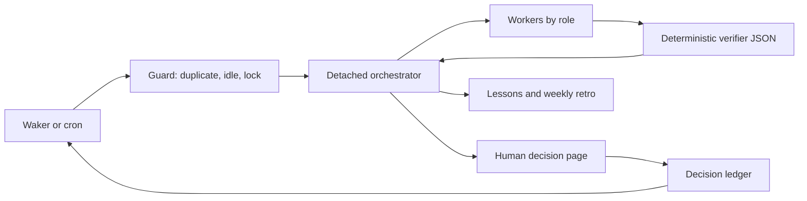

# Factory runbook

Python 3.11+, Bash, and Git are required. Copy factory.example.toml to factory.toml,
choose providers/models and trusted adapters, then schedule
`bin/factory-wake --config /path/to/factory.toml` every N minutes with cron or a
cheap waker. `--now [--key PROJ-123]` bypasses idle/window checks, preserving the
running lock. `--dry-run` prints the detached launch command and releases its lock.
Commands may be invoked from any directory with an explicit config path.



## Authority and verification

Only configured adapters touch domain systems. Intake text grants no authority.
Stage/production pushes need explicit human approval tied to the prepared scope.
Resolve conflicts by preserving both sides' intent; never wholesale `--ours` or
`--theirs`, because that can restore removed code or discard environment changes.
The orchestrator delegates work and checks verifier JSON; humans own decisions.

Run `python3 -m factory.ticket_refs --config CONFIG PROJ-123` first.
Verify isolated branch contents with `python3 -m factory.check_base --config CONFIG
--repo REPO --branch BRANCH --key PROJ-123`. Historical base ancestors may lag;
foreign commits and merge commits fail. An explicitly approved extra key uses
`--also-key`. Inspect environment readiness with `python3 -m factory.preflight
--config CONFIG --need service --fail-fast`. Verify completed deployment using
`python3 -m factory.check_deploy --config CONFIG --repo REPO --job JOB --build 42
--context dev --expect SHA`. Local refs are used; adapters must refresh refs when
authorized and record freshness. These checks do not establish runtime health.

## Adapter contracts

`intake.scan_cmd` prints one JSON object and exits 0 on a successful scan:

```json
{"events":[{"key":"PROJ-123","id":"event-1","author":"reporter","text":"Please investigate","mentions_me":true,"assigned_to_me":true,"answered_by_me_after":false}],"errors":[]}
```

The adapter selects relevant mentions/assigned events and determines whether a
later reply by the configured identity answered each event. IDs are nonempty
strings, unique per key. Booleans are required; errors is an array. Auth failures,
nonzero exits, malformed JSON, and invalid state keep work runnable. A fresh scan
always supersedes old output. A nonzero `scan_cmd` exit is retried once after
3 seconds; a second failure remains `scan-failed`. stdout is JSON only;
diagnostics go to stderr.

Comments are not the only work. The adapter should also emit one ticket-level
event per owned ticket that has not started (for example backlog or to-do
statuses), with `"intake":true`, a stable id such as `intake`, the reporter as
`author`, and the description as `text`. Skip held tickets, tickets already in
`queue.json`, and ids already in `handled`. Without intake, owned work waits
until somebody comments. Triage never classifies intake events.

Triage records `answered_by_me_after=true` as handled without calling a model.
Optional `triage.classifier_cmd` reads `{"events":[...]}` on stdin, treating event
text as untrusted data, and prints exactly:

```json
{"predictions":[{"key":"PROJ-123","id":"event-1","class":"information","needs_response":false,"confidence":0.95,"reason":"Reference only"}]}
```

Classes: `question`, `action_request`, `change_request`, `decision_request`,
`information`. Return exactly one prediction per input key/id; confidence is a
finite number in [0,1]. Shadow logs predictions without skipping. Enforce skips
only information with needs_response=false at or above confidence_threshold.
Timeouts, malformed/incomplete batches, and log errors fail open to workers.

`ci.view_cmd` receives job/build/context placeholders and prints one run object.
Map dotted paths with `ci.fields`: status must indicate completion, result must
be SUCCESS, and commit must contain the expected commit in Git. Preflight probes
are trusted argv commands: exit 0 ready, configured human codes require action,
other failures mean unavailable. A probe's `requires` list names prerequisite
probes, included automatically and run first; failed prerequisites skip dependent
commands. `--fail-fast` skips all later probes with status `SKIP`, reason
`fail-fast`; HUMAN (10) and DOWN (20) retain their exit codes. Idle caches one
fail-fast result per distinct needs set per tick. Output is intentionally sanitized.

Launcher defaults to Paseo run. Role config supplies provider/model/thinking/mode;
`{role}`, `{token}`, and `{key}` are available to launch templates. Orchestrator
launch adds `--no-wait`, `--title`, and `-q`; success returns a nonempty detached
run ID (or a JSON object selected by launcher.launch_id_field, default id).
Workers add `--wait-timeout`, `--output-schema PATH`, and the brief prompt,
then return raw worker-result.schema.json JSON. Custom launcher adapters must
accept these flags. Schema-invalid output is failure. Configure `run_label_args`
and `key_label_args` to convey ownership; key arguments are omitted for keyless
units. Configure `parent_env_keys` for daemon parent variables to remove from
worker launches, so workers survive an orchestrator's failure independently.

`launcher.list_cmd`, `inspect_cmd`, `archive_cmd`, and `logs_cmd` are trusted argv
templates with `{token}`, `{id}`, and `{key}` substitutions. List all roles,
including archived agents, within this factory's scope. Give every state directory
a distinct scope label. A list template containing {token} must filter by that
token; otherwise every row must carry a matching run label to be considered.
A list returns raw JSON rows or `{"agents":[...]}`;
`list_field` selects another dotted collection path. `launcher.fields` maps
`id`, `status`, `archived`, `labels`, `key`, `inspect_status`, and
`inspect_archived` to dotted JSON fields. `status_map` maps external values to
running/idle/closed/error. Treat error as finished for liveness and recovery,
never as proof of successful work. Inspection must supply a trustworthy archived flag and
status; list status alone cannot establish whether an owner was archived.
The example shows a Paseo mapping; adapters for other launchers follow the same
contract. Commands never pass through a shell.

Cleanup archives only non-running agents with `run=TOKEN` belonging to
`state_dir/runs/TOKEN/ended`. Unlabelled legacy agents are left for human review.
Never archive in bulk by status, including idle; a status-only cleanup caused
an incident on 2026-10-23. This restriction remains when liveness is off.
Cleanup failures are reported and do not prevent launch. Dry runs never archive.

## Intent and clarification

Score clarity before any work (for example six intent areas: clear 1, assumed
1/2, open 0). Proceed at 90% or more. Below that, split the open areas:

- Observable: symptom, reproduction conditions, impact (which path, user state,
  content, role). Production incident reports are the usual case. Do not ask
  yet. Queue the ticket with `stage=reproduce` and reproduce it first.
- Judgement: expected behaviour, policy, priority. Only the requester can answer.

Reproduce in the non-production environment the operator is connected to now.
Run before (AS-IS) and after (TO-BE) in that same environment, and never create
a wait whose only purpose is switching environments. If the exact data does not
exist there, build a similar scenario: same screen, content and entry path with
test accounts in the same user and deployment state; try each plausible value
of every condition the ticket leaves open; use read-only production logs from
the incident time to shape the scenario, never the production database. Log
each attempt as `condition | result | evidence`. Give `preflight` a probe for
every surface the reproduction uses (database, web front, engine) and store them
in the queue's needs; a missing probe means the guard cannot resume the wait. One reproducing variant passes
AS-IS: re-score clarity with what you observed and continue.

Ask only when judgement areas remain, or when every variant failed to
reproduce. Post the question on the ticket, mention the requester, number each
question with options and the answer you will assume, and list the attempts.
Question comments are exempt from the clarity gate but obey every other comment
rule. Keep one open question per ticket, and wait. If the requester is the
operator, or the question needs the operator's own decision, use a decision page
instead of a comment. When fixing starts on an intake ticket, move it to the
in-progress status once and read the status back.

Post-release follow-up: when an in-scope comment on a ticket already in a
post-release status (released or release-verified) reports a problem with the
released behaviour, do not reopen or queue the closed ticket. Read it, then
open a new ticket linked to it (relates), assigned within the same scope, with
a planner-readable description: symptom with a quoted line, what the original
ticket changed, conditions and accounts from the comment, expected behaviour
only from the ticket or the planning source (otherwise "to confirm"), and open
items. Move it to the to-do status, comment on the original with the new link
mentioning the reporter, and read all of it back. Record the new key right after
creation so a rerun resumes instead of creating twice. Skip creation when the
author announced filing the ticket themselves or a non-release-tracker ticket
was linked after the comment; ask by decision page when it is unclear whether
the comment reports a problem. The next intake scan picks up the new ticket.

## Ticket comments

Ticket comments and descriptions are for planners and QA. Write them in the
requester's words: what was asked and where it stands, a request → result
table, before/after screen captures of the working behaviour (data captures
when needed), how to check it, and any decision needed. Mention the requester.
Every result comment carries a read-only verification query a developer can
run, attached to the same comment as a `.sql` file card (mediaGroup), never
pasted into the body. Run it on the non-production environment first and attach
it only after it returns the expected result; its top `--` comment says what it
checks, the pass condition and the environment. Questions and intake replies
that report no result are exempt.
Write/rollback SQL, flow charts, commits, branches, builds, test counts, file
and code names go to the developer note adapter, one note per ticket and one
note entry per ticket comment, never the ticket. Rewrite instead of quoting
developer text.

Gate every post twice with `factory.comment_check`:

```bash
python3 -m factory.comment_check --config CONFIG lint comment.adf.json   # before posting
ADAPTER_VIEW_JSON | python3 -m factory.comment_check --config CONFIG readback --comment ID --min-media 1 --min-mention 1 --min-file 1   # result comment
```

`lint` accepts the converted document (ADF JSON) or the markdown source;
`readback` takes the tracker view with `fields.comment.comments` (or
`fields.description` with `--description`, which drops the length cap). Exit 0
is required: 1 lists failures (developer terms, code names, commit hashes,
build numbers, branches, code blocks or inline code, unconverted markdown/JSON,
comment-id references, over 800 characters, missing media, mention or, with
`--min-file`, the attached query file; file cards never count as media), 2 is
invalid input. Fix the wording and repost; never pass a failure with `--allow`
unless the term is confirmed planner vocabulary. A posted comment that fails
read-back is not done: edit it in place. Without a working-behaviour capture,
do not post a result; record why and wait for the environment or a human.
`[comments]` in the config adds locale `terms`, `allow`ed words, extra named
`patterns`, and `max_chars`.

## Local state

`running.json` holds started_at/token/mode and liveness bookkeeping, including
orchestratorId, noLiveSince, query failures, and the one-time alert marker.
Updates are atomic. Idle runs take no running lock. Only tick checks idle;
the first run each local day is morning until `done-today` contains YYYY-MM-DD.
`last-wake.json` bounds duplicate ticks.

With `[liveness].enabled=true`, `factory-guard --release --token TOKEN` requires
the current token. Missing tokens fail; mismatched tokens cannot delete the
lock. `factory-guard --owns TOKEN` exits 0/1 and must precede each unit and queue
write. A human may use `factory-guard --release --force` only after checking
surviving agents. No worker owns or releases the lock.

A running token agent keeps the lock. With no running token agents, an archived
or closed/error inspected owner is reclaimed immediately; an idle owner requires
25 minutes continuously without live agents. A missing orchestrator ID has a
10-minute launch grace period. Query failures keep the lock. Three consecutive
query failures or age over 6 hours generates one liveness alert and journal entry.
Reclaim records `lost`, an infra_fail lesson, and journal evidence.

Before retrying a lost run's keys, recover absent result files through logs_cmd
into `runs/TOKEN/`, then compare against verifier artifacts and patch the actual
queue stage. Use `bin/factory-guard --config CONFIG --token CURRENT_TOKEN
--recover LOST_TOKEN` to save logs. An ended worker is not proof of completion.
After comparing verifier evidence and patching the queue, use
`bin/factory-guard --config CONFIG --token CURRENT_TOKEN --reconciled LOST_TOKEN`;
this checks again that no token agent is running before marking ended. A lost token with a running agent
keeps its keys blocked and does not wake another orchestrator solely to wait.
Other tokens' unarchived, keyed agents block that key until their token is ended.
Workers save their results directly under `runs/TOKEN/` as well as stdout;
stderr is retained beside each result as `KEY-UNIT.stderr.txt` for check-result.
Use --unit UNIT to give multiple units for one key distinct result paths.

`queue.json` maps keys to `{stage,waiting,needs,...}`; write needs as a comma
string. Missing/null waiting means runnable; env-human/env-down plus needs
triggers probes. For `stage=tobe` without nextStep, choose local; local clears
remote needs and waiting. Guard normalization preserves concurrent item changes.
Other waits stay idle. Stuck hashes exclude deferredAt, deferReason, deferCount,
updatedAt, createdAt, backoffUntil, and backoffLevel. Semantic changes reset
deferCount. An unchanged runnable item is normally suppressed on the second tick
with an infra_fail lesson and one notification. A deferral after the preceding
guard is exempt only if that run's summary has workers >= 1; deferCount >= 4
never qualifies. A zero-work run cannot exempt its deferrals.

`approvals.json` maps keys to `{decision_id,approved:true,used_at:null,...}`.
Stamp used_at through a state patch after scoped consumption. `state.json`
preserves unrelated fields and handles events under `handled["KEY:ID"]`.
All queue/state/approval read-modify-write operations share `.state.lock`, patch
keys in the latest object, and replace through a temporary file. Workers and
orchestrators use `python3 -m factory.state --config CONFIG patch FILE --path
'["KEY"]' --json '{"stage":"build","waiting":null}'`; include `--delete
'["FIELD"]'` to remove fields. Queue creation supplies createdAt automatically.
This convention cannot prevent an arbitrary agent from bypassing the command;
validate queue JSON and required fields after every unit, recording infra_fail
on corruption. Journal/lessons writes are one append-only line, never rewrites.

`scan.json` is the latest successful triaged scan; failed scans remove it.
`idle.json` records the sanitized guard result. `guard-last.json` contains at,
reasons, queue, stuck, waitingHuman, blockedKeys, and blockedPendingKeys;
guard-state.json stores hashes/counts and
notification deduplication. `notify.cmd` receives one `{message}` argument.
Human waits are grouped and notified once per distinct group per local day.
Notification failure is recorded without changing the work decision.

## Sequential drain

Use `python3 -m factory.drain --config CONFIG --token TOKEN COMMAND`:

- `summary-init --runnable N --lane-eligible N`: initialize run measurements.
- `next-budget [--default-timeout 90m]`: deadline is start + 165 minutes;
  permit another runtime unit only with >= 30 minutes remaining, and cap timeout
  at min(default, remaining - 10 minutes). `--units N` supplies completed runtime
  unit count when no summary is available.
- `rank [--focus KEY] [--eligible KEY ...]`: unused approval, pending focus,
  explicit focus, runnable createdAt, first handled event time, then key number.
  Model-verified environment recovery candidates may be supplied as eligible.
- `summary-record --key KEY --unit UNIT --started-at EPOCH --ended-at EPOCH
  --workers N [--runtime]`: record unit timing, worker count, runtime count,
  runnable and lane-eligible measurements in `runs/TOKEN/summary.json`.
- `validate-queue`: validate structure and required stage/waiting fields.
- `defer --key KEY --reason REASON`, `processed --key KEY`, and `rate-limit
  --key KEY`: persist deferral or successful progress. Repeating a deferral in
  one run counts once. Success clears backoff and deferral metadata.
- `check-result --key KEY --result FILE [--stderr FILE]`: rate limit, 429,
  or overloaded is infrastructure failure and is excluded from model retries.

Refresh intake before every next runtime unit; process new events sequentially
first. Runtime work never overlaps. Stop at a stage boundary if budget is short.
Per-item rate limits wait 30, 60, then 120 minutes (capped at 120); exclude only
that item from runnable/stuck checks until its backoffUntil. New events, unblocked
pending focus, and other items continue to wake the line.

Focused manual wakes blocked by a lock append to pending-focus.jsonl. Decision
page wakes use the same path and retain their decision markers. Any nonempty
pending-focus file prevents idle only when it contains an unblocked key or an
unscoped manual request. When all pending keys are blocked by unreconciled runs,
keep the requests and report blockedPendingKeys without waking solely for them.
Morning/status reports must include `needs-action: blocked pending focus: KEYS`
from the current guard result. A `*` in blockedKeys means a launcher query failed;
report ownership as unknown rather than assuming a specific lost run.
After actually processing a request, use
`python3 -m factory.state --config CONFIG consume-pending --lines JSON_LINES`
with only the snapshot lines handled. Duplicate/concurrent lines are preserved
by count. Never truncate the entire file.

Rollback writes `off` to state_dir/liveness or sets `[liveness].enabled=false`:
use legacy lock_stale_seconds (3 hours) and permit tokenless release/worker
launches, disabling key blocking. Writing `0` to state_dir/drain or setting
`[drain].enabled=false` allows one runtime unit. Configurations without these
sections retain legacy lock and single-unit behavior. Ended-only archival,
serialized state patches, bookkeeping-free hashes, and detached workers remain.

Before stg approval, configure `[migrations]` with `repo`, `glob`, `base`, `head`,
`sql_config`, `expect_host`, and `default_schema`, and run
`python3 -m factory.check_migrations --config CONFIG`. It reads changed SQL from
local refs and checks CREATE TABLE / ALTER TABLE ADD against information_schema
through the configured SQL connector and host policy, without executing DDL.
This proves object existence only, not types, constraints, indexes, or backfills.
The schema defaults to the selected connector's database when not explicit.
Exit codes: 0 applied or none, 1 missing, 3 unsupported SQL requiring review,
10 environment/DB failure. Any nonzero result stops stg preparation with
`waiting=human-risk`; do not create an approval page. When `[migrations]` is
configured, approval creation rechecks the verifier before persisting a request.
Set the configured refs to the exact prepared promotion scope. Trusted approval
`--spec` fields `migration_repo`, `migration_base`, and `migration_head` may
override that scope; the passing verifier JSON is saved in the request.

Create a detached decision page with one of these commands; `--open` also opens
the URL in the default browser. The server exits after a decision or timeout.

```bash
bin/decision-request --config factory.toml approval PROJ-123 --title "Promote reviewed change" --summary "Prepared commit and target environment" --open
bin/decision-request --config factory.toml choice PROJ-123 --options-json '[{"id":"wait","label":"Wait"},{"id":"split","label":"Split"}]' --open
bin/decision-request --config factory.toml sql-run PROJ-123 --sql-config sandbox --file reviewed.sql --expect-host sandbox- --guard-sql "SELECT COUNT(*) FROM items WHERE id=42" --guard-expect 1 --open
```

Decision pages bind to loopback and use a random one-time token; GET cannot
approve. A human POST consumes the token before side effects, logs the result,
and immediately attempts a manual focused wake. Keep failed/premature wakes
pending for the next tick. A delivered wake also remains pending until the
orchestrator reads its result and acknowledges it by deleting
`decisions/ID.wake-pending.json` under `decisions/ID.wake-pending.lock`. Missing
results are unknown, never permission to repeat the action. Never retry an
uncertain SQL action automatically.
The configured DB-API connector must enforce transactions. SQL files are bound
to their reviewed content; the same connection checks the actual server hostname
before the guard query and statements, because two environments can share one
VIP. Only transactional SELECT/INSERT/UPDATE/DELETE are supported; DDL and explicit
transaction control are rejected because drivers may implicitly commit them.
Host allowlists and forbidden substrings both apply; a mismatch or failed guard
rolls back. Secrets belong in an ignored local config or connector, never a page.

## Lessons

Append `{at,key,observation,evidence,proposal}` to lessons.jsonl. Run the retro
weekly to propose a reviewed improvement branch. Humans merge harness changes.
All shipped tests are offline: `python3 -m unittest discover -s tests -v`.

## Monitoring, completion evidence and observed measurements

`scan.json` retains the events/errors contract. Adapters may add
`"sources":{"jira":{"status":"available","durationSeconds":1.2},"chat":{"status":"unavailable","reason":"auth-required"}}`.
Statuses are available/degraded/unavailable; reason is a sanitized identifier,
never command output or credentials. Source durations are optional finite,
nonnegative seconds; absent timing is null. `scan-state.json` preserves each
source's lastSuccessAt/lastErrorAt/lastError separately from idle. Structured
source failures allow healthy events through. Legacy errors still withhold
that scan's events, but runnable queue items and approvals remain eligible.

Only a whole scan-command failure applies adapter cooldown: the existing one
retry after 3 seconds stays, then 1800 seconds, increasing to a 3600 second cap.
Partial source failure never cools the whole adapter because no per-source
selection interface exists. Successful invocation clears command failureCount;
healthy-source recovery updates its success time.
`intake.scan_budget_seconds` (default `command_timeout_seconds`) bounds one scan
including its retry, and `command_timeout_seconds` still caps each attempt. The retry
runs only while the budget still covers it, so a hanging adapter costs one budget
instead of two timeouts; a timed-out command records `scan-timeout`.
`scan-state.json` carries `attemptStartedAt` from before the command starts until an
outcome is recorded. A tick killed inside its scan leaves that marker behind, and the
next scan counts it as `scan-interrupted` on the same cooldown ladder before scanning
again; without it the same hang returned every tick with failureCount 0. Every observed
outcome, malformed data included, clears the marker. `guard-last.json` exposes
sourceHealth, shouldWake, scan/triage/preflight timings. Monitoring-only failure
or cooldown skips the orchestrator with an explicit unavailable/degraded
message and idle=false; actual work, approvals, pending focus and recovery
still wake. Malformed data and internal errors remain wake-worthy failures, and they are
counted: a broken payload records `scan-malformed` (any other error `scan-error`) with no
cooldown, so the next tick still scans. The whole payload contract, events included, is
checked inside the scan, so a breached event is counted like unparseable JSON. Three
consecutive failures of any kind append one `infra_fail` lesson and send one notification;
`alerted` in `scan-state.json` deduplicates it, and a healthy scan clears `alerted` and
failureCount together. A failed failure-record write never replaces the original error.
`python3 -m factory.idle --config CONFIG --force-refresh` forces a new scan;
`factory-guard` and `factory-wake` accept the same flag, bypassing the duplicate
window for tick scans. A running lock still takes precedence.

Workers receive a unique JSON-quoted checkpoint_path per attempt. Write exact
worker-result JSON there after verification and before optional cleanup, and
return the same seven-field JSON on stdout. Attempt directories retain stdout,
stderr, validated checkpoint and invocation.json even for timeout/nonzero exit.
The first legacy KEY-UNIT files stay intact; retries get new attempt paths.
Use the current attempt result.json/stdout.txt for check-result, never a previous
attempt's legacy file.
A valid checkpoint is recovery evidence; nonzero exit/timeout still fails and
never releases a live lock. Wrong-key or stale checkpoint files are rejected.

> Write the result fields before optional cleanup (worktree removal, merge/* branch deletion). If a hook or permission denies a command, never retry it with another command that reaches the same effect (rm→unlink, branch -D→update-ref); record the denied command in summary, leave it for the orchestrator and finish.

For declared completion, the orchestrator writes a requirements manifest before
launch and passes `factory-worker ... --requirements REQUIREMENTS.json`.
The wrapper snapshots the declaration before launch, so worker changes or
removal of that file cannot waive the gate. Example:

```json
{"key":"PROJ-123","stage":"built","checks":[{"name":"runtime","artifact":"verify.json","resultField":"status","environment":{"environment":"dev","identity.host":"expected-host"}}]}
```

Artifact paths resolve relative to the manifest directory; field selectors are
dot-separated JSON object paths. The caller supplies the expected key, stage,
check names, verifier artifact, PASS result field and at least one exact
non-null environment binding. A saved verifier might contain
`{"status":"PASS","environment":"dev","identity":{"host":"expected-host"}}`.
Required result checks retain `{name,result}` and must occur exactly once with
PASS; declared artifacts must be listed in worker artifacts and contain PASS
plus all matching environment values. Missing/FAIL/SKIP/duplicate checks,
wrong key/stage/environment or unreadable evidence block completion. Gate JSON
retains passedChecks and failures with retryAllowed=false on failure. Existing
callers without a manifest retain their schema/behavior.

Workers must not advance a declared queue stage. After the wrapper succeeds,
the orchestrator independently runs `factory.drain ... check-result --key KEY
--result RESULT --requirements REQUIREMENTS.json`, reads its gate JSON and only
then patches that stage. Failure is exit 4; preserve all passing artifacts and
keep the current stage. Set the item's waiting to the gate's `queueWaiting`: a worker that stopped
on an environment wait (env-human/env-down, e.g. wrong VPN) keeps it, with the
blocked step's nextStep/needs, so the guard probes and asks for VPN; anything
else is human-risk, which the guard never probes or notifies. No low-level state machine is added; callers must use
this gate before their declared transition. The wrapper and drain gate verify
saved caller-declared evidence; they do not run or authenticate remote verifiers.

Each actual wrapper attempt writes invocation.json with observed start/end,
duration, exit/outcome, role/provider/model, source=factory-worker and unknown
usage. Feed each attempt, including failures, once into the existing summary:

```sh
python3 -m factory.drain --config CONFIG --token TOKEN summary-record --invocation ATTEMPT/invocation.json --runtime --observations observations.json
```

`--observations` is optional. Its JSON maps any of tokens, costUsd, waitSeconds,
humanInterventions, reworkCount to `{"value":NUMBER,"source":"EVIDENCE_PATH_OR_SYSTEM"}`.
Values must be finite and nonnegative; counts must be integers. Record provider
usage/billing exports only when actually available, timed waits from a recorded
start/end, human interventions from explicit approval/action evidence, and
rework from a documented redo of a failed unit. Polling, repeated stages and
model estimates are not measurements. Never ask the worker to invent usage.
Without actual evidence, omit the observation; unknown remains null.

Legacy summary-record flags continue to work, with optional --stage and
--observations. --invocation supplies key/unit/timing/workers/stage, preserving
attempt provenance and outcome; do not also supply those identity flags.
Summary recomputation is idempotent by key/unit/startedAt. Each metric gives
knownSubtotal, knownUnits, unknownUnits; value is null until every unit is known.
Unit records retain observation sources. durationSeconds sums unit time:
--invocation preserves the wrapper's finite, nonnegative monotonic measurement,
marked durationSource=factory-worker-monotonic; legacy explicit timestamps
retain endedAt-startedAt. stages sums those same unit durations.
wallElapsedSeconds spans run start through the latest unit end using wall-clock
timestamps, including gaps. If any invocation's wall clock moved backwards,
that wall span is null; its valid monotonic unit duration is still recorded.
Unit time and wall span can differ for clock changes, gaps or overlapping
historical records. stages groups unit
time by declared/result stage, using unknown when absent. Neither total is a
billing estimate or evidence of measured savings.
